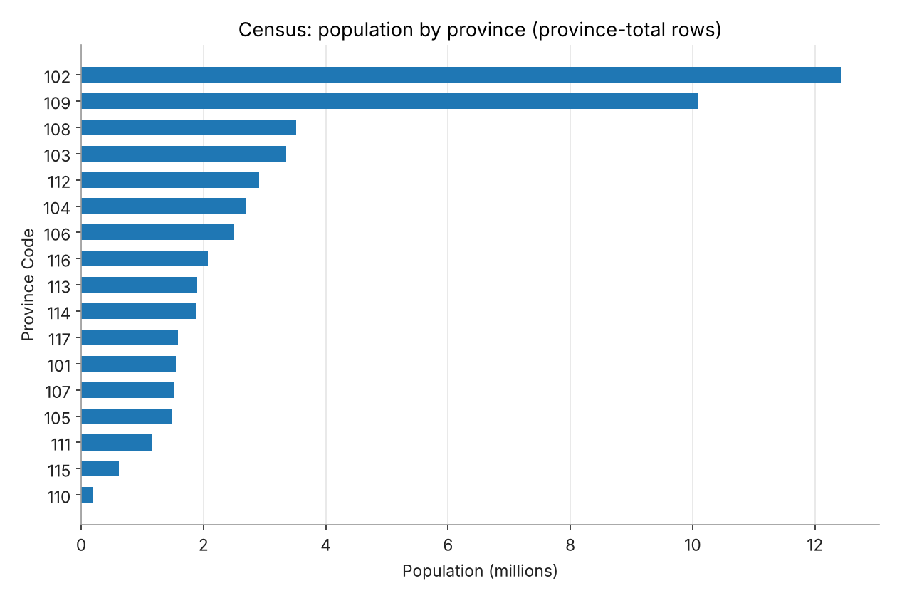
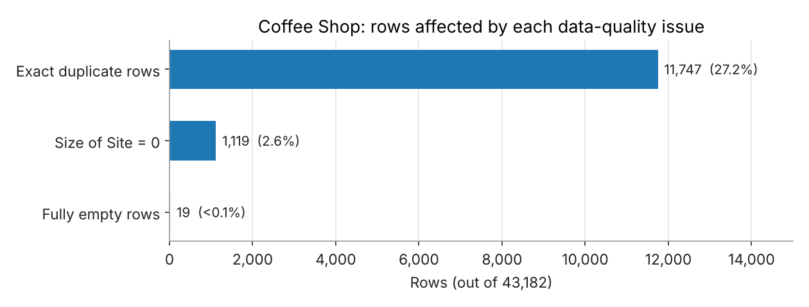
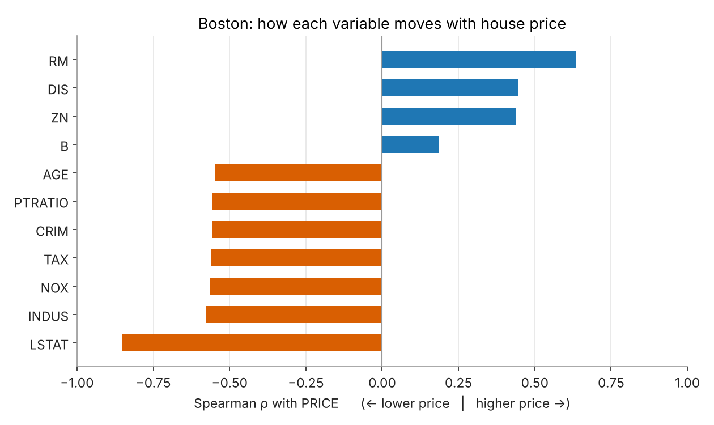
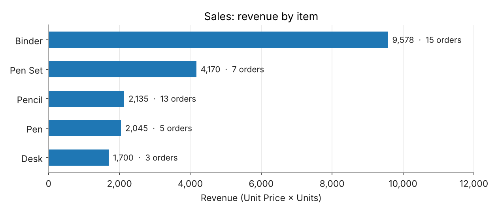
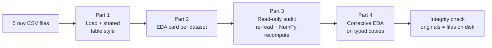

# 📊 Five Datasets — EDA, Reproducibility Audit & Corrective EDA


[](https://colab.research.google.com/github/Alhano1f/My-Work-in-SIC_AI/blob/main/five-datasets-eda/five_datasets_eda.ipynb)

A careful, self-checking exploratory analysis of **five CSV datasets** (Boston housing, Census, Coffee Shop, Sales and Student List, **44,029 rows** in total). Every dataset gets a standard EDA card. Then a **read-only audit** re-reads each file and recomputes every statistic with NumPy to prove the numbers are right, and a **corrective EDA** fixes what the audit uncovered: wrong data types, hidden totals, duplicates and outliers.

> **Scope:** this project covers exploration, auditing and data-quality fixes. All fixes are made on **copies**, so the original data is never changed. It does **not** train a model; it documents what each dataset needs before one can be built.

---

## 📌 Highlights

| | |
|---|---|
| **Datasets analysed** | 5 CSV files · 44,029 rows · 36 columns |
| **Audit result** | Every pandas statistic reproduced with NumPy (largest difference 2.4 × 10⁻¹²) |
| **Biggest quality issue** | Coffee Shop: 11,747 exact duplicate rows (27.2%) |
| **Hidden type errors** | Census `Population` and `Households` stored as text, e.g. `" 10,078,850 "` |
| **Hidden double counting** | Census mixes 18 province-total rows with city rows |
| **Originals untouched** | Final integrity check: all 5 DataFrames still identical to the files on disk |

### Datasets

| Dataset | File | Rows | Columns | Missing cells | Duplicate rows |
|---|---|---:|---:|---:|---:|
| Boston | `data_boston.csv` | 506 | 14 | 0 | 0 |
| Census | `data_census.csv` | 281 | 6 | 0 | 1 |
| Coffee Shop | `data_coffeeshop.csv` | 43,182 | 3 | 57 | 11,747 (27.2%) |
| Sales | `data_sales.csv` | 43 | 5 | 0 | 0 |
| Student List | `data_studentlist.csv` | 17 | 8 | 0 | 0 |

---

## 🔍 Key findings

**1. The first-pass numbers hold up.** The audit re-read all five files (UTF-8, comma-delimited, line counts match row counts) and recomputed each statistic with NumPy. The largest gap from the pandas results was 2.4 × 10⁻¹², so the EDA tables can be trusted.

**2. Census hides two traps.** `Population` and `Households` are stored as text with spaces and thousands separators, so a naive analysis treats them as categories. Province totals (City Code `1001`) are also mixed in with city rows: they add up to 51.4 M people, but summing every row gives 112.8 M because of double counting. City-level statistics therefore exclude the total rows. Provinces 102 and 109 are by far the largest.

<p align="center"></p>

**3. Coffee Shop needs cleaning before any analysis.** Over a quarter of the rows are exact duplicates. They are kept, not deleted, because there is no ID column to tell identical shops apart. 1,119 sites have a size of 0 and 19 rows are completely empty. One site of 24,075 is about 20× the next largest (1,206.4), which points to an entry error. Sites marked `In` (69.5%) are larger and newer than those marked `Out` (median size 55.7 vs 46.4, median start year 2013 vs 2010).

<p align="center"></p>

**4. Boston prices follow neighbourhood status and room count.** `LSTAT` (share of lower-status population, ρ = −0.85) and `RM` (rooms per dwelling, ρ = +0.63) have the strongest links with `PRICE`. `PRICE` is capped at 50 (16 houses sit exactly at the cap), and `CRIM` is highly skewed (skew 5.24). `CHAS` and `RAD` look numeric but are categorical, so they are excluded from correlations.

<p align="center"></p>

**5. In Sales, a few items drive revenue.** The file has no revenue column, so it is derived as `Unit Price × Units`. Binders bring in 9,578 of the 19,628 total (49%). Desks sell only 3 times but earn 1,700 because of their high unit price. The Central region accounts for 57% of revenue, and higher unit prices go with fewer units per order (r = −0.39).

<p align="center"></p>

**6. Student List is clean but tiny.** It has no missing values or duplicates, but its 17 students make every statistic fragile. Height and weight are moderately correlated (r = 0.66). `Grade` is ordinal, and `Gender`, `Absence` and `Bloodtype` are categorical.

---

## 🛠️ How the analysis works



| Part | Notebook cells | What it produces |
|---|---|---|
| **1 · Load** | 1.1 – 1.3 | The five DataFrames, one shared table style, and a two-row preview of each file |
| **2 · Exploratory analysis** | 2.0 – 2.5 | One card per dataset: size, missing values, duplicates, column overview, numeric and categorical statistics |
| **3 · Audit** | 3.1 – 3.2 | File fingerprint (MD5), encoding, delimiter, line counts, numbers stored as text, NumPy re-computation |
| **4 · Corrective EDA** | 4.1 – 4.9 | Typed copies, variable roles, robust statistics, frequencies, IQR outliers, correlations, group comparisons, preprocessing notes, integrity check |

### Corrections found by the audit (applied to copies only)

| Dataset | Issue | Fix / recommendation |
|---|---|---|
| Boston | `CHAS` (0/1) and `RAD` (index) stored as integers | Treated as categorical and excluded from correlations |
| Boston | `PRICE` capped at 50; `CRIM`, `ZN`, `B` heavily skewed | Account for the cap in modelling; use log transforms or robust methods |
| Census | `Population`, `Households` stored as text | Strip spaces and commas, convert to `int64` |
| Census | Province totals (City Code `1001`) mixed with cities | Excluded from city-level statistics; a code book is needed for the remaining sub-totals |
| Census | City Code repeats across provinces | Identify cities by (Province Code, City Code) |
| Coffee Shop | 19 empty rows, 1,119 sizes of 0, one 24,075 outlier | Drop or flag empty rows, treat 0 as missing, investigate the outlier, use medians |
| Coffee Shop | `Year of Start` is a float only because of missing values | Stored as a nullable integer (`Int64`) |
| Sales | `Date` stored as text (`04-Jul-14`) | Parsed to `datetime` (range Jul 2014 – Jun 2015) |
| Sales | No revenue column | Derived as `Unit Price × Units` |
| Student List | `Grade` stored as a number | Treated as ordinal; `Gender`, `Absence`, `Bloodtype` as categorical |

**Design rules:** the audit is read-only, every fix works on a copy, skewed data is summarised with medians, Spearman ρ and IQR outliers, and every relationship is reported as an association, not a cause.

---

## 🚀 Getting started

**Quickest:** click **Open in Colab** above, upload the five CSV files to `/content/`, and choose *Runtime → Run all*.

**Locally:**

```bash
# 1. Clone and install
git clone https://github.com/Alhano1f/My-Work-in-SIC_AI.git
cd My-Work-in-SIC_AI/five-datasets-eda
pip install pandas numpy jinja2 notebook

# 2. Open the notebook
jupyter notebook five_datasets_eda.ipynb
```

> The five CSV files are not stored in this folder. The notebook reads them from `/content/` (Colab's default folder). When running locally, change that path in cell 1.1 to the folder that holds the files.

---

## 📁 Project structure

```
five-datasets-eda/
├── five_datasets_eda.ipynb   # load → EDA → audit → corrective EDA → integrity check
├── figures/                  # charts of the notebook's results, used in this README
└── README.md
```

---

## ⚠️ Limitations

- **Small samples.** Sales (43 rows) and Student List (17 rows) are too small for stable statistics.
- **Duplicates are ambiguous.** Without an ID, Coffee Shop duplicates may be repeated records or genuinely identical shops, so they are kept and flagged.
- **Census sub-totals remain.** Some city rows still exceed their province total, so they are probably intermediate sub-totals. They cannot be separated without a code book.
- **Correlations are descriptive, not causal.**

## 🔭 Next steps

- Apply the preprocessing notes to produce a cleaned version of each dataset.
- Obtain the Census code book to separate the remaining sub-total rows.
- Build a baseline price model on Boston that accounts for the cap at 50.
- Add distribution plots (histograms, box plots) inside the notebook.

---

## 🧰 Tech stack

Python · pandas · NumPy · hashlib · Jupyter / Google Colab
