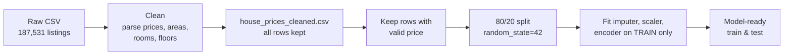

# 🏠 House Prices — EDA, Data Cleaning & Leakage-Aware Preprocessing


An end-to-end, reproducible data-preparation project on **187,531 Indian real-estate listings**. It takes a messy scraped dataset — prices written as `"78 Lac"` or `"1.2 Cr"`, areas in nine different units, floors like `"3 out of 12"` — and turns it into a clean analytical table plus a **model-ready train/test split** built without data leakage.

> **Scope:** this project covers exploration, cleaning and preprocessing. It does **not** train or evaluate a price-prediction model — it prepares the data so that one can be built correctly.

---

## 📌 Highlights

| | |
|---|---|
| **Listings analysed** | 187,531 rows × 21 raw columns |
| **Usable prices** | 177,847 listings with a valid positive price (9,684 had `Call for Price` or unparseable values) |
| **Median asking price** | ₹7,800,000 (₹78 lakh) |
| **Possible duplicates** | 122,292 rows flagged — kept, not deleted (no reliable property ID) |
| **Model-ready output** | 142,277 train / 35,570 test rows, **99 features** after encoding |

---

## 🔍 Key findings from the EDA

**1. Location dominates price.** Among the 12 cities with the most listings, New Delhi (₹160 L) and Gurgaon (₹157 L) have median asking prices roughly **4× Vadodara (₹39 L)**. Bangalore and Hyderabad sit in the middle at ₹82–85 L.

<p align="center"></p>

**2. Prices are heavily right-skewed.** About 64% of listings fall between ₹10 lakh and ₹1 crore (94% below ₹3 crore), with a long tail of luxury properties, so the distribution is shown on a log₁₀ scale — a hint that any future model should predict `log(price)`.

<p align="center"></p>

**3. Data quality is the main challenge.** `Plot Area` and `Dimensions` are 100% empty, and `Society`, `Super Area` and `Car Parking` are each missing in more than half of the rows.

<p align="center"></p>

**4. Room counts move together.** Bedrooms and bathrooms are strongly correlated, as are floor number and total floors. Linear (Pearson) correlations with raw price are weak, which is expected given the skew and extreme values.

<p align="center"></p>

**5. The market is mostly semi-furnished or unfurnished** — fully furnished homes are a small minority of listings.

<p align="center"></p>

📄 Full write-up with the missing-value table: [`reports/EDA_REPORT.md`](reports/EDA_REPORT.md)

---

## 🛠️ How the data is processed



### Cleaning (`clean()` in `src/process.py`)

| Raw field | Example | Becomes | Rule |
|---|---|---|---|
| `Amount(in rupees)` | `78 Lac`, `1.2 Cr` | `price_inr` | Lac/Lakh → ×10⁵, Cr/Crore → ×10⁷; `Call for Price` → missing (never 0) |
| `Carpet Area`, `Super Area` | `1200 sqft`, `150 sqyrd` | `*_sqft` | Converted from sqft, sqyrd, sqm, acre, hectare, cent, marla, kanal, ground; unknown units stay missing |
| `Title` | `3 BHK Flat for Sale…` | `bedrooms` | Extracted from the "N BHK" pattern |
| `Bathroom`, `Balcony` | `2`, `> 10` | `*_count` | Exact integers only — `> 10` is *not* treated as 10 |
| `Floor` | `3 out of 12` | `floor_number`, `total_floors` | Parsed into two numeric columns |
| `Car Parking` | `1 Covered` | `parking_count` | Number of covered/open spots |
| `location` + categoricals | ` New-Delhi ` | `new-delhi` | Trimmed and normalised; blanks → missing |
| *(whole row)* | — | `possible_duplicate_listing` | Flag only, no deletion |

Dropped columns: `Plot Area` and `Dimensions` (completely empty) and `Index` (administrative).

### Preprocessing for modelling — designed to avoid leakage

- **Split first, fit second.** The 80/20 train/test split happens *before* any imputer, scaler or encoder is fitted, so no test-set statistics leak into training.
- **Numeric features:** median imputation + missing-value indicator columns + standard scaling.
- **Categorical features:** missing → `"Unknown"`, then one-hot encoding with rare levels (< 100 occurrences) grouped.
- **Target leakage blocked:** `Price (in rupees)` (price per sq ft) is kept for exploration but **never** used as a feature — it is derived from the target.
- **Free text** (`Title`, `Description`) is retained for traceability but excluded from the default feature set.

**Features used:** `location`, `Furnishing`, `Transaction`, `Ownership`, `facing`, `carpet_area_sqft`, `super_area_sqft`, `bathroom_count`, `balcony_count`, `bedrooms`, `floor_number`, `total_floors`, `parking_count`.

---

## 🚀 Getting started

```bash
# 1. Clone and install
git clone https://github.com/Alhano1f/My-Work-in-SIC_AI.git
cd My-Work-in-SIC_AI/house-prices-eda-preprocessing
pip install -r requirements.txt

# 2. Unzip the raw data into data/  (the script expects data/house_prices.csv)
mkdir -p data
unzip "Raw Data/house_prices.zip" -d data

# 3. Run the cleaning + preprocessing pipeline
python src/process.py

# 4. Explore interactively
jupyter notebook notebooks/01_house_prices_eda.ipynb
```

Running `src/process.py` generates:

| Output | Description |
|---|---|
| `data/house_prices_cleaned.csv` | All 187,531 listings with 29 cleaned / engineered columns |
| `data/preprocessor.joblib` | The fitted scikit-learn `ColumnTransformer`, reusable on new data |
| `data/split_indices.npz` | Exact train/test row indices, for reproducibility |
| `reports/processing_summary.txt` | Row counts, split sizes and feature count |

> The unzipped CSV (~106 MB) and generated files are git-ignored to keep the repository small.

---

## 📁 Project structure

```
house-prices-eda-preprocessing/
├── Raw Data/
│   └── house_prices.zip            # original dataset (zipped, ~6 MB)
├── notebooks/
│   └── 01_house_prices_eda.ipynb   # step-by-step EDA → cleaning → preprocessing
├── src/
│   └── process.py                  # reusable cleaning + leakage-aware pipeline
├── reports/
│   ├── EDA_REPORT.md               # findings and decisions
│   ├── processing_summary.txt      # pipeline output stats
│   └── figures/                    # charts used in this README
├── requirements.txt
└── README.md
```

---

## ⚠️ Limitations

- **Duplicates may inflate scores.** With 122K possible duplicate rows and no property ID, a random split can put the same property in both train and test. Use group-aware splitting once a reliable ID is available.
- **Correlations are descriptive, not causal.**
- **Asking prices ≠ sale prices.** The data reflects listings, not completed transactions.

## 🔭 Next steps

- Train baseline models (linear regression on `log(price)`, gradient boosting) on the prepared split.
- Add outlier handling for implausible areas and prices.
- Build city-level or group-aware validation to get realistic performance estimates.

---

## 🧰 Tech stack

Python · pandas · NumPy · scikit-learn · Matplotlib · Jupyter · joblib
