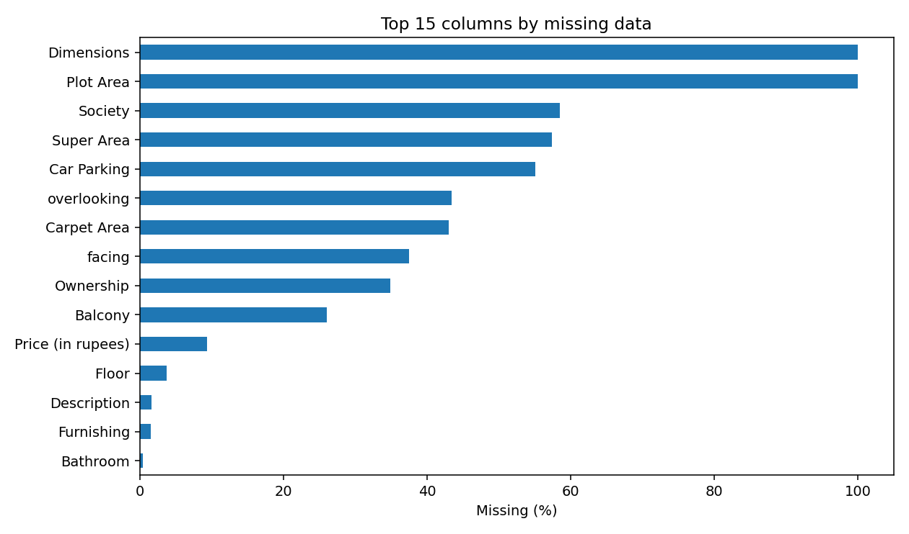
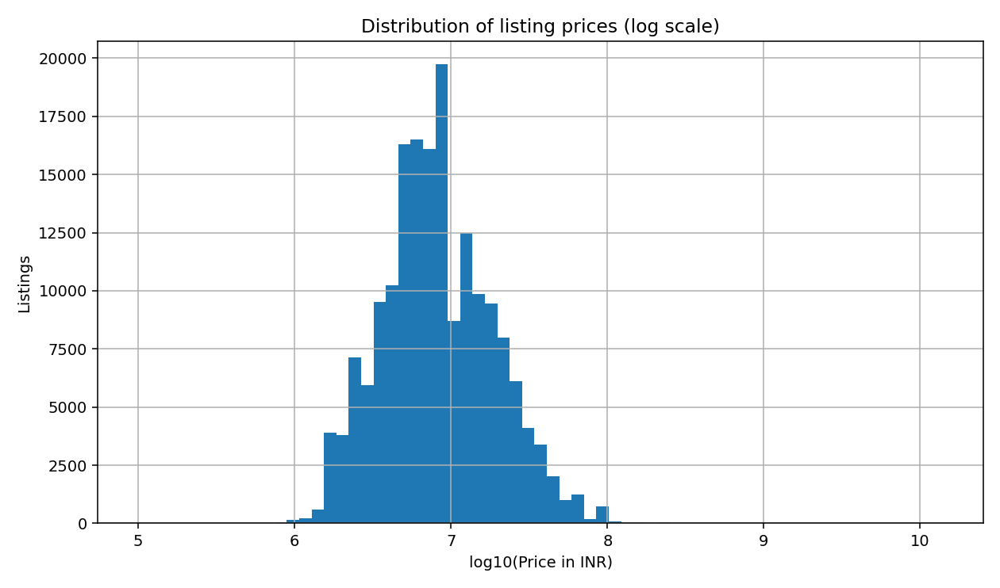
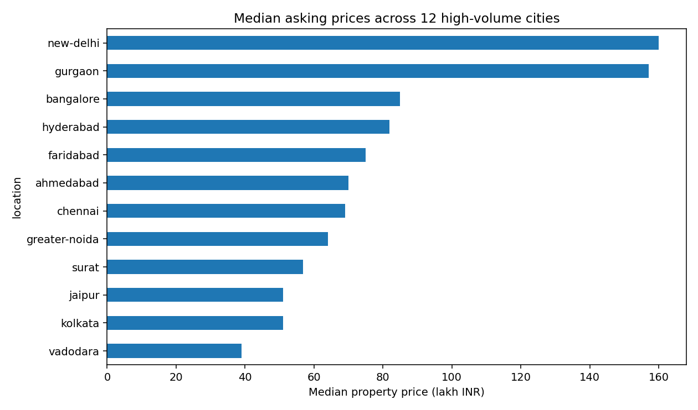
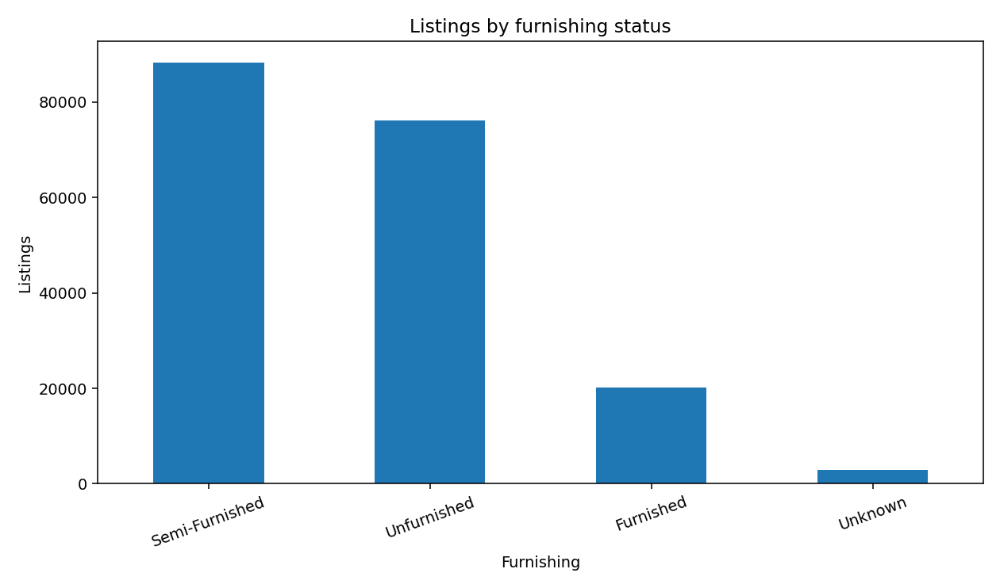
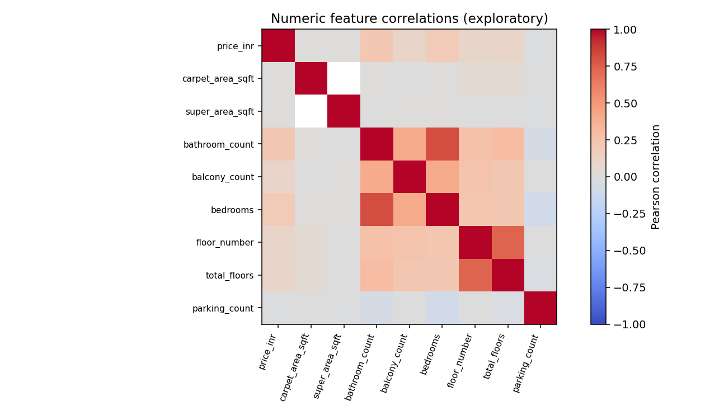

# House Prices: Exploratory Data Analysis and Preprocessing

## Dataset overview
- Total listings: **187,531**
- Original columns: **21**
- Listings with valid positive numeric price: **177,847**
- Missing/unavailable listing prices: **9,684**
- Median listed price (valid listings): **₹7,800,000**
- Rows flagged as potentially duplicate (excluding artificial Index): **122,292**

## Missingness (raw fields)
| Field | Missing count | Percent |
|---|---:|---:|
| Plot Area | 187,531 | 100.0% |
| Dimensions | 187,531 | 100.0% |
| Society | 109,678 | 58.5% |
| Super Area | 107,685 | 57.4% |
| Car Parking | 103,357 | 55.1% |
| overlooking | 81,436 | 43.4% |
| Carpet Area | 80,673 | 43.0% |
| facing | 70,233 | 37.5% |
| Ownership | 65,517 | 34.9% |
| Balcony | 48,935 | 26.1% |
| Price (in rupees) | 17,665 | 9.4% |
| Floor | 7,077 | 3.8% |
| Description | 3,023 | 1.6% |
| Furnishing | 2,897 | 1.5% |
| Bathroom | 828 | 0.4% |
| Status | 615 | 0.3% |
| Transaction | 83 | 0.0% |
| Amount(in rupees) | 0 | 0.0% |
| Title | 0 | 0.0% |
| Index | 0 | 0.0% |
| location | 0 | 0.0% |

## Charts

## Cleaning and preprocessing decisions
- Preserve original listings. Because there is no verified unique property ID, possible duplicate rows are flagged instead of being deleted.
- Remove completely empty columns (`Plot Area`, `Dimensions`) and administrative `Index` from the cleaned feature table.
- Convert `Lac` and `Cr` strings to INR; `Call for Price` becomes missing, not zero.
- Convert recognized area units to square feet; unknown units remain missing.
- Parse bedrooms from title, bathrooms/balconies, floor position, and parking count; unrecognized formats remain missing.
- Keep rich title and description in cleaned data for traceability, but exclude from the default model feature set.
- Do not use `Price (in rupees)` / listing price per square foot as a house-price-prediction feature, since it may leak target information.
- For a modeling demonstration, split into 80% training and 20% test before fitting imputers, scalers, and categorical encoders.
- Median-impute numeric values, add numeric missingness indicators, standard-scale numeric features, fill categorical missing values with `Unknown`, and one-hot encode categoricals (rare levels grouped).
- Keep all rows in `house_prices_cleaned.csv`; rows without a valid positive target are excluded only from the model-ready split.
- Since listings may represent duplicated properties, random split performance can be optimistic. Use property/group-aware splitting when reliable listing IDs are available.

## Important scope limitation
This project performs EDA and preprocessing, not model training or predictive performance evaluation. Correlations are descriptive, not causal.
